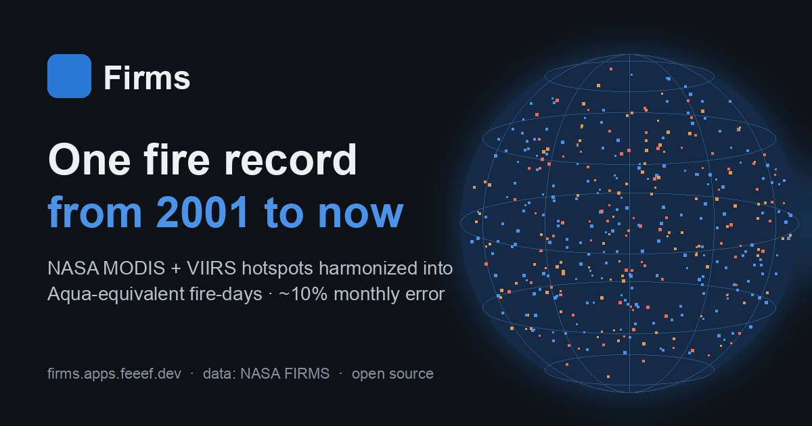
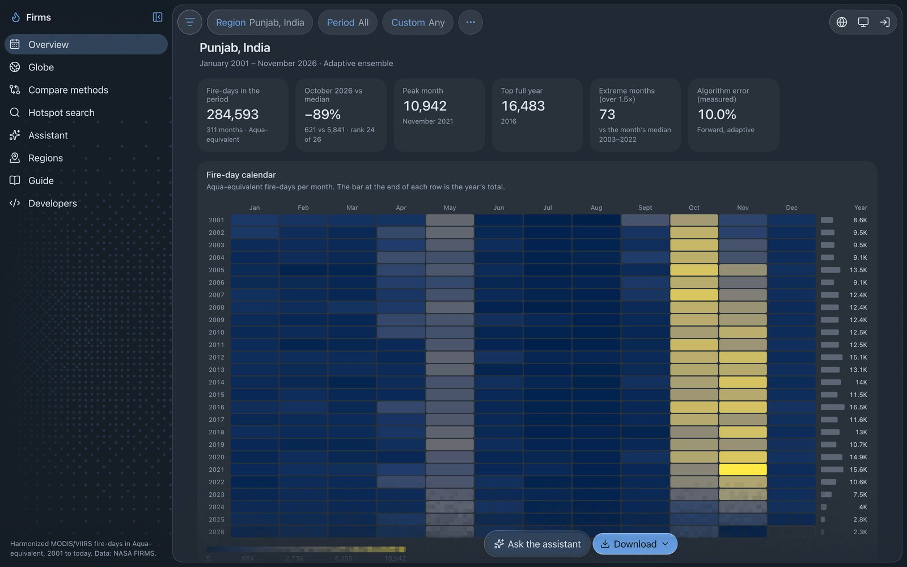
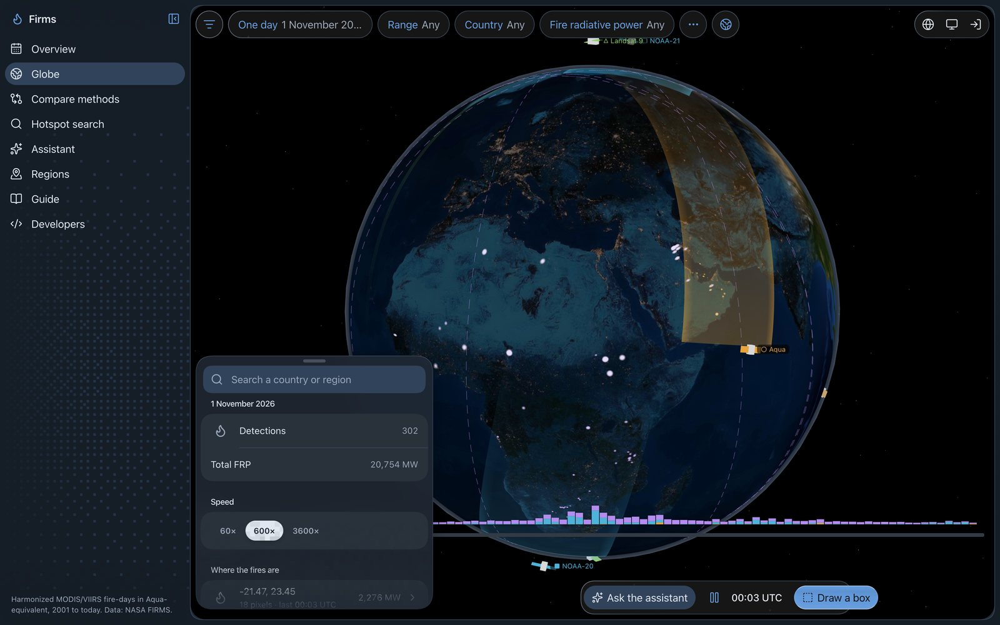
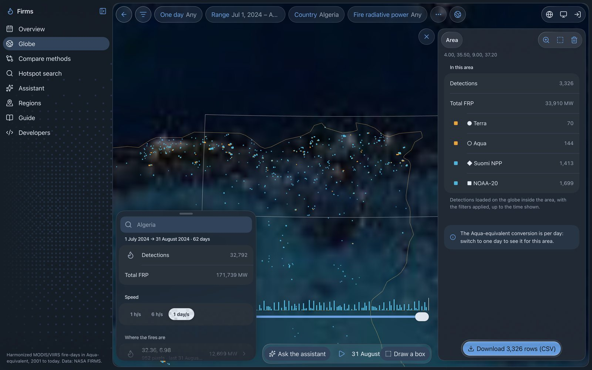
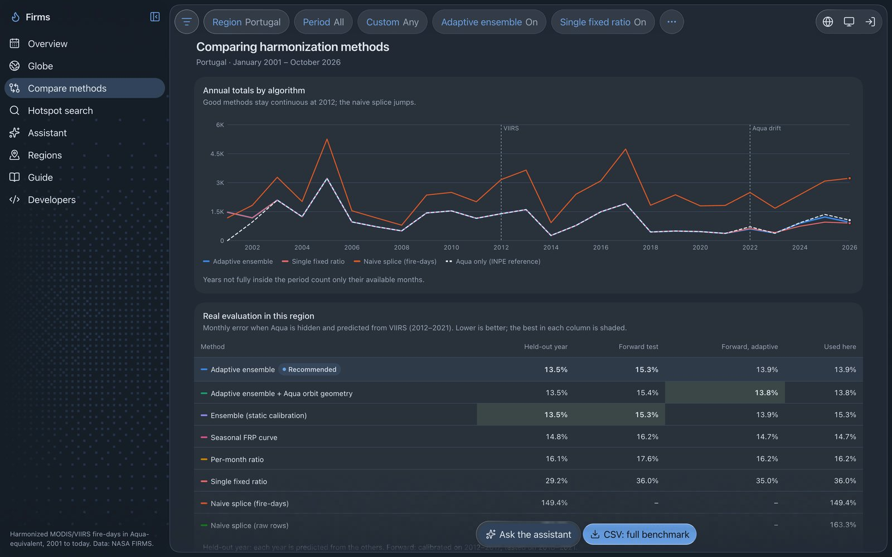
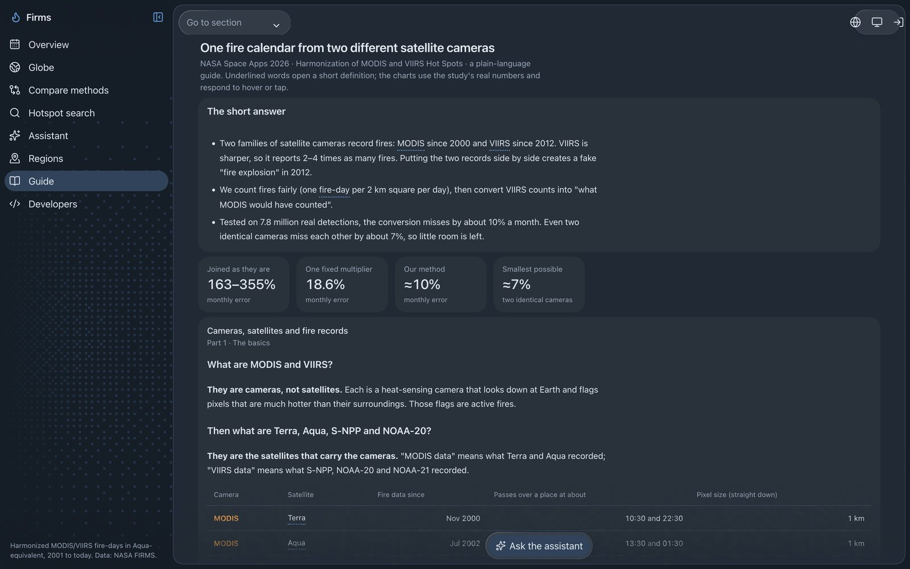
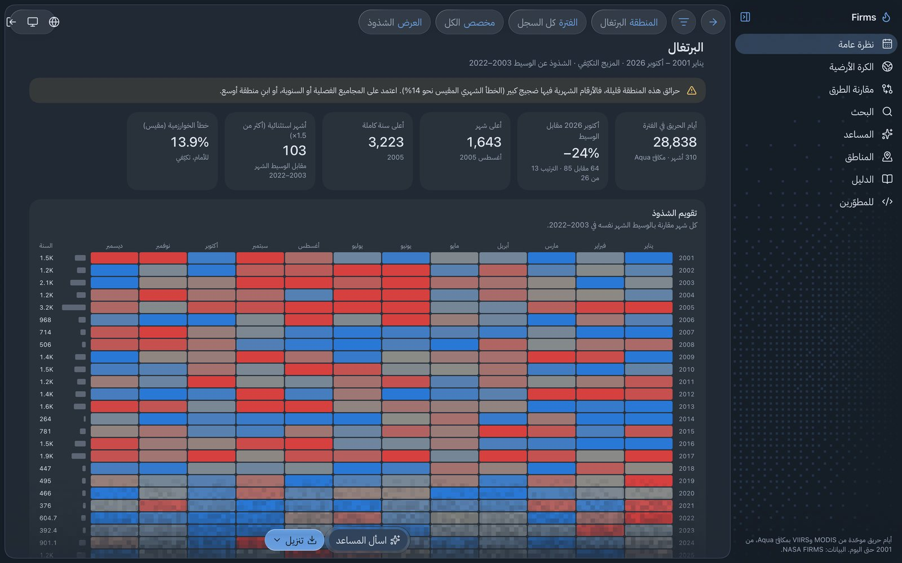

<p align="center">
  
</p>

<p align="center">
  <a href="https://firms.apps.feeef.dev"><b>Live app</b></a> ·
  <a href="https://firms.apps.feeef.dev/guide"><b>Guide</b></a> ·
  <a href="#use-it-from-an-ai-assistant-mcp"><b>MCP</b></a> ·
  <a href="#api"><b>API</b></a> ·
  <a href="docs/ARCHITECTURE.md"><b>Architecture</b></a>
</p>

<p align="center">
  <a href="LICENSE"></a>
  
  
  
  
</p>

# Firms

**One wildfire record from 2001 to now.** NASA's two fire-detecting cameras, MODIS (since 2000) and VIIRS
(since 2012), see fires very differently: VIIRS reports 2–4 times as many. Joined as they are, the records
show a fire "explosion" in 2012 that never happened. Firms counts fires fairly (*fire-days*) and converts
every month into one unit, **Aqua-equivalent fire-days**, so 25 years of fire seasons can be compared.
Built for the NASA Space Apps 2026 challenge *Harmonization of MODIS and VIIRS Hot Spots*.

| | Monthly error |
|---|---|
| Records joined as they are | 163–355% |
| One fixed multiplier | 18.6% |
| **Firms (adaptive ensemble)** | **≈ 10%** |
| Floor: two identical VIIRS satellites predicting each other | ≈ 7% |

Tested on 7.8 million real detections with leave-one-year-out and forward (learn from the past, predict
the future) designs. The [guide](https://firms.apps.feeef.dev/guide) explains every step in plain language,
with interactive charts.

## What you can do

### The fire calendar

Every month since 2001 for a region, as counts or as anomalies against the 2003–2022 median of the same
month, with yearly totals, this month's rank among all years and the method's measured error.



### The globe

Every NASA FIRMS pixel at its real size and orientation on a WebGL Earth. A day plays with the satellites
on their orbits and their scan swaths; any date range can be loaded for a country (from 2001 for the
calibrated ones) or a drawn area. Filter by satellite, sensor, confidence, fire power and day/night, pick a
pixel to see what the satellite measured, or draw a box to count, convert and download what is inside.





### Compare the methods

Nine ways to join the records, side by side on real data: annual totals, the held-out evaluation and the
months predicted against what Aqua actually saw.



### The guide, in the app

Cameras and satellites, fire-days, the conversion, how it was tested, the 7% floor, results per region, the
2022 orbit drift and how to read the calendar, with twelve interactive figures.



### Arabic first, English second

The interface is bilingual and right-to-left ready; light and dark themes follow the system.



### An assistant that drives the app

Ask in plain words ("how did Algeria's 2024 season compare with the last ten years?", "show last week's
fires in Spain at night above 20 MW"). Every number comes from a tool call on the data, and the assistant
opens what it talks about: it filters the globe, flies the camera and draws areas. It runs on feeef Cloud AI
with the signed-in user's account.

## Use it from an AI assistant (MCP)

The same tools are an MCP server at `https://firms.apps.feeef.dev/mcp`, with OAuth sign-in, typed outputs
and two interactive widgets (a calendar and a hotspot map).

- **Claude** (web or desktop): Settings → Connectors → Add custom connector → `https://firms.apps.feeef.dev/mcp`
- **ChatGPT**: Settings → Apps & Connectors → Advanced → Developer mode → Create → that URL, OAuth
- **Cursor**: `~/.cursor/mcp.json` → `{"mcpServers":{"firms":{"url":"https://firms.apps.feeef.dev/mcp"}}}`
- **Claude Code**: `claude mcp add --transport http firms https://firms.apps.feeef.dev/mcp`

Tools include `find_region`, `get_calendar`, `get_anomalies`, `get_trend`, `seasonal_profile`,
`rank_regions`, `compare_algorithms`, `search_hotspots`, `hotspot_stats`, `range_summary`, `live_convert`
and `export_calendar_csv`. For language models there are also
[`/llms.txt`](https://firms.apps.feeef.dev/llms.txt) and [`/llms-full.txt`](https://firms.apps.feeef.dev/llms-full.txt).

## API

Public JSON, no key needed for reading:

```sh
curl "https://firms.apps.feeef.dev/api/regions"
curl "https://firms.apps.feeef.dev/api/calendar?region=portugal&from=2020-01&to=2025-12"
curl "https://firms.apps.feeef.dev/api/range?country=algeria&from=2024-07-01&to=2024-07-31"
curl "https://firms.apps.feeef.dev/api/hotspots?bbox=-9.6,36.9,-6.1,42.2&days=3&format=csv"
```

Every route is described in [`docs/ARCHITECTURE.md`](docs/ARCHITECTURE.md) and [`server/README.md`](server/README.md).

## The method

1. **Clean**: MODIS confidence ≥ 30, VIIRS drops `low`; every 2 km cell that ever held a static heat source
   (gas flares, industry, volcanoes) is masked.
2. **Count fairly**: a *fire-day* is a 0.02° (~2 km) cell with at least one detection on a local solar day.
3. **One reference per period**: Terra converted until June 2002, Aqua from July 2002 to 2021, VIIRS converted
   to Aqua-equivalent from 2022, when Aqua's orbit started drifting (it now passes near 15:15, not 13:30).
4. **Convert**: the average of a per-month Aqua/VIIRS ratio and a seasonal, isotonic curve of the chance Aqua
   also sees a cell given the fire radiative power VIIRS measured.
5. **Stay current**: calibration on 2012–2021 with each year's weight halving every two years back.

The code is in [`tools/harmlib.py`](tools/harmlib.py); the benchmark of every tested method is in
[`data/benchmark.json`](data/benchmark.json).

## Run it yourself

```sh
cp .env.example .env     # FIRMS_PUBLIC_ORIGIN at least; a NASA FIRMS MAP key unlocks live data
docker build -t firms .
docker run -p 8080:8080 -v firms-data:/data --env-file .env -e FIRMS_PUBLIC_ORIGIN=http://localhost:8080 firms
```

Develop the pieces separately:

- **Server** (Rust, axum): [`server/README.md`](server/README.md), with `cargo run`, `cargo test` and `cargo clippy`.
- **Web** (React 19, Vite, three.js): [`web/README.md`](web/README.md), with `npm run dev`, or
  `FIRMS_MOCK=1 npm run dev` to run on the seed data without a server.
- **Harmonization** (Python): `python3 tools/harmonize.py --name=… --country=… --bbox=W,S,E,N` downloads a
  country's FIRMS archive (2001 to today), tests the methods and adds the region.

The web app is built on feeef's UI kit (`@feeef.dev/ui`). A Docker build without access to the kit uses the
committed bundle in `web/prebuilt`, so the image always builds.

```
server/   Rust: API, MCP + OAuth, the agent, SEO (robots, sitemap, llms.txt)
web/      React app: calendar, globe, compare, search, guide, assistant
tools/    Python: harmonization and FIRMS data fetchers
data/     seed regions and the benchmark
docs/     architecture and images
```

## Data and credits

- Fire detections: **NASA FIRMS**. *We acknowledge the use of data and/or imagery from NASA's Fire Information
  for Resource Management System (FIRMS) (https://earthdata.nasa.gov/firms), part of NASA's Earth Science Data
  and Information System (ESDIS).*
- Satellite orbits from public TLEs (CelesTrak) via `satellite.js`.
- Base imagery: NASA Blue Marble and Black Marble (via `three-globe`), Esri World Imagery tiles when zoomed in.
- Country shapes: Natural Earth (public domain) via `world-atlas`.

## Contributing

Issues and pull requests are welcome: new regions, better methods (with their benchmark numbers), fixes and
translations. Run `cargo test` and `npm run build` before sending a change. Please report security issues
privately as described in [SECURITY.md](SECURITY.md).

## License

[MIT](LICENSE) © feeef
